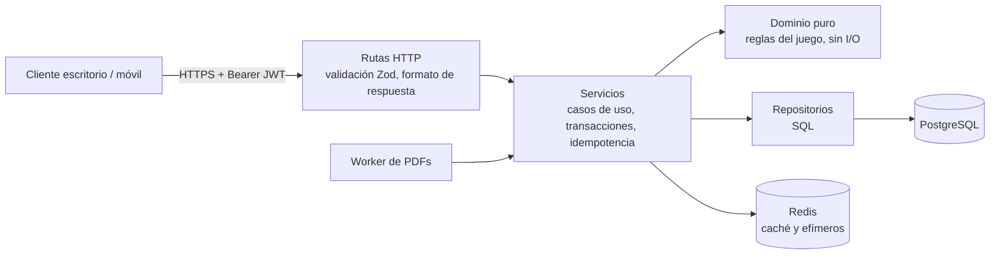

# Mochi API

Backend único para los clientes de escritorio, móvil y web de Mochi Roadmap. Todos los clientes consumen exactamente la misma API. Sirve el estado del compañero (HP, MP, STA, empatía, sueño), el árbol de habilidades, el crafteo con recetas reales y las misiones que salen de los PDF.

**Stack:** Node 20+, TypeScript estricto, Fastify 5, Zod, PostgreSQL 16 (`ltree`), Redis (opcional) y jose (JWT).

```bash
cp .env.example .env          # ajusta DATABASE_URL, REDIS_URL y JWT_SECRET
npm install
npm start                     # migra, carga el catálogo, levanta la API y el worker de PDFs
npm test                      # 23 pruebas: dominio + integración contra Postgres y Redis reales
```

Las pruebas de integración usan `TEST_PG_ADMIN` (por defecto `postgres://postgres@127.0.0.1:5433/postgres`) y `TEST_REDIS`. Cada corrida crea y borra su propia base. Con `TEST_PDF=/ruta/guia.pdf` también prueban la importación real de un PDF.

---

## 1. Capas



| Capa | Carpeta | Regla |
| --- | --- | --- |
| Rutas | `src/http/routes` | Solo traducen HTTP: validan con Zod, llaman a un servicio y responden `{ data, meta }`. No tienen lógica. |
| Servicios | `src/services` | Un caso de uso por función. Abren la transacción, validan reglas de negocio y suben la revisión del usuario. |
| Dominio | `src/domain` | Funciones puras: `computeSnapshot`, `taskXp`, `pokeReaction`, `rollEffects`, `recipeKey`… Reciben la hora como dato y se prueban sin base de datos. |
| Repositorios | `src/repos` | Todo el SQL vive aquí. Aceptan el pool o un cliente de transacción. |
| Infraestructura | `src/infra` | Pool de Postgres con `statement_timeout`, caché (Redis o memoria) y lector de PDF. |
| Catálogo | `src/catalog` | Recetas, objetos y árbol semilla, versionados con el código. `npm run seed` es idempotente. |

El lector de PDF es **el mismo archivo** que usa el cliente (`../src/parser.js`), así que hay una sola fuente de verdad.

## 2. Base de datos

El esquema está en `db/migrations/001_init.sql` y tiene seis grupos separados:

| Grupo | Tablas | Naturaleza |
| --- | --- | --- |
| Usuarios | `users`, `devices`, `refresh_tokens` | Identidad y sesiones por dispositivo |
| Estado del compañero | `pet_state`, `pet_daily` | **Anclas** y contadores diarios, no valores vivos |
| Catálogo global | `skill_nodes`, `skill_prereqs`, `items`, `recipes`, `recipe_ingredients` | Igual para todos y versionado |
| Progreso | `user_skills`, `roadmaps`, `roadmap_phases`, `roadmap_tasks`, `user_task_progress`, `user_phase_progress`, `task_reward_ledger` | Por usuario |
| Inventario y cosméticos | `user_inventory`, `user_equipment` | Por usuario |
| Crafteo | `user_discoveries`, `craft_log` (particionado por mes) | Por usuario; el registro solo se agrega |
| Sincronización | `user_rev`, `change_log`, `idempotency_keys`, `pdf_imports` | Soporte |

### Árbol de habilidades sin joins pesados

Cada nodo guarda dos representaciones del árbol:

- **`parent_id`**, para la integridad y para editar.
- **`path` (`ltree`)**, un camino materializado como `ciencias.quimica_basica.metalurgia`, con índice GiST.

Pedir una rama es **una sola consulta**, sin CTE recursivo: `path <@ 'ciencias'` filtra por índice, y el `LEFT JOIN user_skills` va por clave primaria.

Los prerrequisitos que cruzan ramas (por ejemplo, *Fermentación* pide *Química básica*) son un DAG aparte en `skill_prereqs`. "¿Qué me falta para desbloquear?" también se resuelve en una consulta (`missingRequirements`).

**Medición** con 111.110 nodos y 600.000 filas de progreso de 30 usuarios:

```
Nested Loop Left Join
  -> Bitmap Index Scan on skill_nodes_path_gist   (path <@ 'r3.n7')
  -> Index Only Scan using user_skills_pkey        (user_id, skill_id)
Execution Time: 4.9 ms
```

Desbloquear una habilidad es una transacción que hace todo esto: bloquea la fila del usuario, valida los requisitos, descuenta los puntos con un `UPDATE … WHERE skill_points >= cost` e inserta en `user_skills`.

## 3. Sincronización entre dispositivos

**Sin estado en el servidor.** El token de acceso es un JWT de 15 minutos con el usuario y el dispositivo. Cualquier instancia lo verifica sin consultar nada. El token de refresco:
- es opaco y se guarda solo su hash;
- **rota en cada uso**;
- si alguien presenta uno ya rotado, se revoca todo el dispositivo (detección de robo).

**Tres mecanismos para que dos dispositivos no se pisen:**

1. **Comandos atómicos en vez de "guardar todo el estado".** El cliente no manda su versión del mundo: manda intenciones (`PUT /v1/tasks/:id/completion`, `POST /v1/craft`). El servidor calcula el resultado dentro de una transacción, y cuando es necesario bloquea las filas involucradas (`pet_state`, `user_inventory … FOR UPDATE`). Una prueba lanza dos crafteos simultáneos que compiten por la última levadura: uno responde 200 y el otro 422, nunca dos panes.
2. **Concurrencia optimista** para ediciones directas, como renombrar al compañero: se envía `If-Match: "v7"`. Si otro dispositivo cambió primero, la respuesta es **409 `VERSION_CONFLICT`** con el estado actual en `details.current`.
3. **Idempotencia.** Los comandos aceptan `Idempotency-Key`. Un reintento por mala red devuelve la misma respuesta, con el encabezado `Idempotent-Replayed: true`, sin repetir el efecto. La llave se guarda en la misma transacción que el efecto.

**Ponerse al día.** Cada mutación sube `user_rev.rev` y anota en `change_log` qué entidades cambiaron. Así:
- **`GET /v1/me/state`** carga todo de una vez cuando el dispositivo arranca en frío, y entrega `meta.rev`.
- **`GET /v1/sync?since=N`** devuelve solo lo que cambió desde la revisión N, con las secciones ya hidratadas (`pet`, `inventory`, `skills`…).
- Si N ya fue podado, la respuesta es **410 `SYNC_CURSOR_EXPIRED`** y el cliente vuelve a `/v1/me/state`.

Todas las respuestas tienen la forma `{ data, meta: { serverTime, rev } }`.

## 4. El compañero sin ticks

**No hay un proceso que reste HP cada minuto.** Se guardan solo anclas:
- `last_activity_at`, la racha, la XP y la empatía;
- un contador diario: tareas hechas, acciones de aprendizaje, despertares nocturnos, efectos sorteados, curas y refuerzos.

Los valores vivos se **calculan al leer** con `computeSnapshot(anclas, contadores, horaDelServidor, zonaDelUsuario)`. Por ejemplo, el HP es `100 − 25 × (días sin avanzar − 1)`. Es una cuenta, no una escritura.

**Caché.** La instantánea se guarda en Redis con la clave `pet:snap:{usuario}:{rev}`:
- **Cualquier mutación sube `rev`**, así que la instantánea vieja deja de usarse sola, sin borrarla.
- **El TTL** es el tiempo hasta `validUntil`, el próximo cambio natural (cambio de fase o medianoche), con un máximo de 5 minutos.
- **El cliente** recibe `validUntil` y no necesita volver a pedir antes de esa hora si nada cambió.
- **Sin Redis**, todo se recalcula desde Postgres. La caché nunca es la fuente de verdad.

**Lo que es efímero vive solo en Redis:** la ventana de toques de 45 segundos y la pausa de 60 segundos. Tocar al compañero de día **no escribe en Postgres** salvo cuando cambia la empatía.

**Anti-trampas.** El servidor decide si duerme, con su propio reloj y la zona horaria guardada del usuario. La hora del dispositivo no participa. Cambiar la zona horaria tiene un enfriamiento de 24 horas (`422 TIMEZONE_COOLDOWN`). Los efectos de mal dormir se sortean de forma determinista la primera vez que se leen en el día y quedan **fijos en la base**: todos los dispositivos ven lo mismo y recargar no cambia la suerte. La energía de cada tarea (combo, racha, efectos, equipo) y el material de recompensa también los calcula el servidor.

## 5. Errores

Todo error tiene la misma forma:

```json
{ "error": { "code": "INSUFFICIENT_MATERIALS", "message": "Te faltan materiales…", "details": { "missing": [...] }, "requestId": "…" } }
```

| HTTP | Códigos | Qué debe hacer el cliente |
| --- | --- | --- |
| 400 | `VALIDATION_FAILED` | Corregir la entrada; `details` dice el campo |
| 401 | `UNAUTHENTICATED`, `TOKEN_EXPIRED` | Con `TOKEN_EXPIRED`, renovar con `/v1/auth/refresh` y reintentar |
| 404 | `NOT_FOUND` | — |
| 409 | `VERSION_CONFLICT`, `ALREADY_EXISTS` | Usar `details.current` y volver a intentar |
| 410 | `SYNC_CURSOR_EXPIRED` | Pedir `/v1/me/state` |
| 413 / 415 | `PAYLOAD_TOO_LARGE`, `UNSUPPORTED_MEDIA` | — |
| 422 | `PET_ASLEEP`, `PET_ON_PAUSE`, `INSUFFICIENT_MATERIALS`, `SKILL_REQUIRED`, `SKILL_LOCKED`, `NOT_ENOUGH_SKILL_POINTS`, `TIMEZONE_COOLDOWN`, `IDEMPOTENCY_MISMATCH` | Regla de negocio: mostrar el mensaje |
| 429 | `RATE_LIMITED` | Esperar lo que indica `Retry-After` |
| 503 | `DEPENDENCY_UNAVAILABLE` | Reintentar con espera (`Retry-After`) |
| 500 | `INTERNAL` | Reportar el `requestId` |

**Para que ningún cliente quede colgado:**
- **Consultas:** `statement_timeout` de 4 segundos en Postgres.
- **Solicitudes:** `requestTimeout` de 20 segundos en Fastify.
- **PDF:** responde 202 de inmediato y se procesa en una cola aparte.
- **Límite de tasa:** 300 solicitudes por minuto por usuario, contado en Redis para que valga entre instancias.

## 6. Endpoints

| Método | Ruta | Notas |
| --- | --- | --- |
| POST | `/v1/auth/register`, `/login`, `/refresh`; `/logout` | Un token por dispositivo (`platform`: `desktop`, `mobile` o `web`) |
| GET | `/v1/me/state` | Arranque en frío |
| GET | `/v1/sync?since=N` | Cambios incrementales |
| PUT | `/v1/me/timezone` | Con enfriamiento |
| GET / PATCH | `/v1/pet` | PATCH exige `If-Match` |
| POST | `/v1/pet/poke`, `/feed`, `/interactions` | El servidor decide la reacción |
| PUT | `/v1/pet/equipment/:slot` | — |
| GET | `/v1/skills/tree?root=&depth=` | Rama plana ordenada por camino |
| POST | `/v1/skills/:slug/unlock` | Valida requisitos y puntos |
| POST | `/v1/craft` | Ingredientes + proceso; nunca revela recetas no descubiertas |
| GET | `/v1/discoveries` | Solo lo descubierto, más el total |
| POST | `/v1/imports` | `Content-Type: application/pdf` → 202; el mismo archivo no se procesa dos veces |
| GET | `/v1/imports/:id`, `/v1/roadmaps`, `/v1/roadmaps/:id` | — |
| PUT / DELETE | `/v1/tasks/:id/completion` | Idempotentes por naturaleza |

## 7. Escalar

- **API sin estado:** se agregan instancias detrás de un balanceador. El estado efímero está en Redis y el durable en Postgres.
- **Worker de PDFs:** puede correr aparte (`RUN_IMPORT_WORKER=false` en la API). Usa `FOR UPDATE SKIP LOCKED`, así que varios workers no se pisan.
- **`craft_log`:** particionado por mes. El job de mantenimiento crea la partición siguiente, poda `change_log` (30 días) y `idempotency_keys` (24 horas).
- **Lecturas pesadas** (árbol, catálogo): se pueden mover a una réplica de lectura sin tocar los servicios, porque los repositorios reciben un `Queryable`.

## Pendiente (siguiente paso)

- **Archivos de PDF:** pasarlos a almacenamiento de objetos (S3 o R2). Hoy `pdf_imports.file_bytes` los guarda en la base y se limpian al procesarlos.
- **Aviso en vivo entre dispositivos:** un canal SSE o WebSocket que solo diga "subió la revisión", para que el otro dispositivo llame a `/v1/sync` sin esperar.
- **Plaza (comunidad):** llevarla a tablas propias (`posts`, `replies`, `gifts`) con moderación. Hoy vive en el almacenamiento compartido del artefacto.
- **Migración del cliente:** que `src/app.js` deje `localStorage` y use esta API (bootstrap + sync + comandos). La lógica de dominio ya es la misma.
